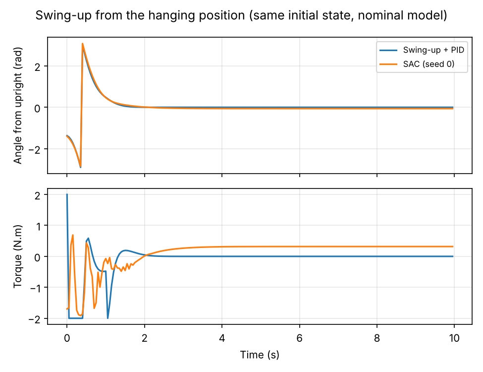
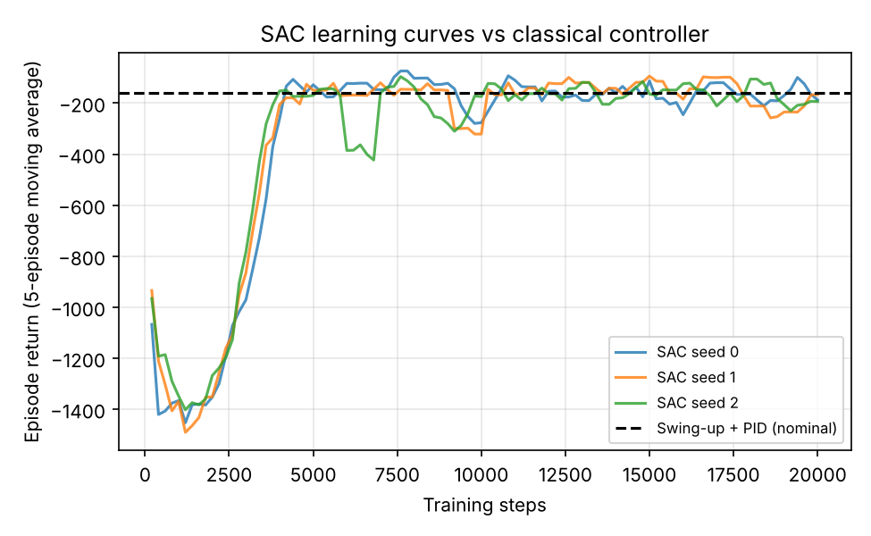
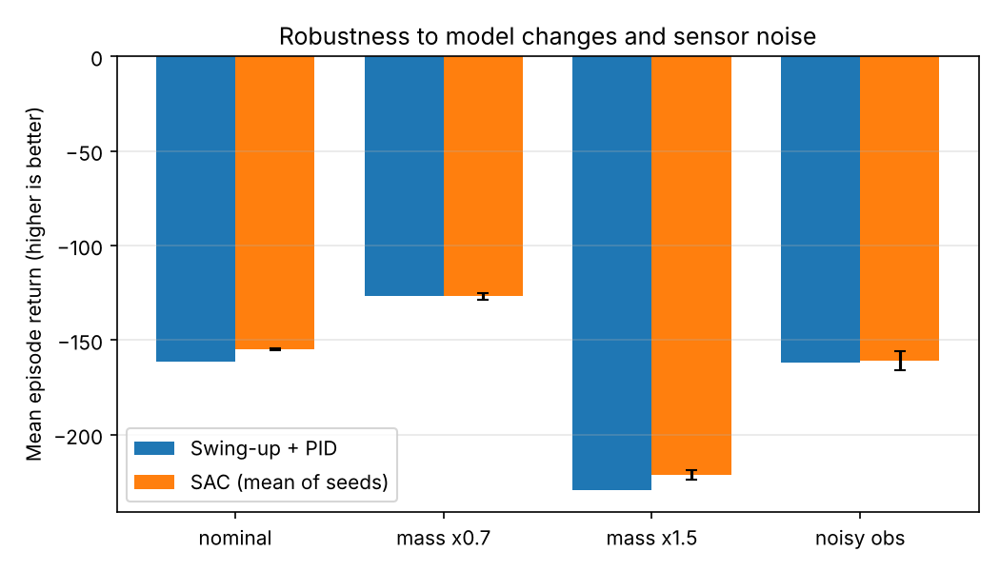

# Inverted pendulum: classical control vs. reinforcement learning

Does a learned controller beat a classical one on the inverted-pendulum swing-up task?
This small project compares a **model-based controller (energy-based swing-up + PID stabilisation)**
with a **Soft Actor-Critic (SAC) agent** on Gymnasium's `Pendulum-v1`, under the same
conditions and with the same evaluation episodes.

It is a learning project that connects my background in automatic control with reinforcement learning,
not a research result.



## Task
`Pendulum-v1`: a torque-limited pendulum (|u| <= 2 N.m, too weak to lift it directly) must swing up from a random
initial state and balance upright (theta = 0) for 200 steps (10 s). The reward penalises angle, angular velocity and torque,
so a higher return (closer to 0) is better.

## Methods
**Classical controller** (`src/classical.py`)
- Swing-up: energy-based control. Torque is applied along the direction of motion in proportion to the energy
  error `E - E_top`, which pumps energy into the pendulum.
- Stabilisation: a PID law near the upright position (`Kp = 12, Kd = 2.5`, **`Ki = 0`, so in practice a PD controller**;
  an integral term is implemented but disabled). The controller switches mode on angle and speed thresholds.
- It uses the nominal pendulum model (m = 1 kg, l = 1 m, g = 10).
- The energy gain was chosen with a small grid search on 30 episodes (seeds 0-29). Evaluation uses different seeds (1000+).

**Learned controller** (`src/train_sac.py`)
- SAC from `stable-baselines3` with default hyperparameters, `MlpPolicy`, 20,000 training steps (100 episodes),
  3 random seeds (0, 1, 2). No hyperparameter tuning.

**Evaluation** (`src/evaluate.py`): 100 episodes per scenario, identical initial states for every controller.
Success = mean |theta| < 0.1 rad over the last 50 steps.

| Scenario | What changes |
|---|---|
| nominal | default environment |
| mass x0.7 / x1.5 | pendulum mass is changed (neither controller is told) |
| noisy obs | Gaussian noise (sigma = 0.1) added to the observation |

## Results
Mean over 100 episodes. The SAC row is the mean of the 3 training seeds.

| Scenario | Controller | Mean return | Success rate | Mean abs. torque (N.m) |
|---|---|---|---|---|
| nominal | Swing-up + PID | -161.4 | 100 % | 0.25 |
| nominal | SAC | -154.7 | 100 % | 0.41 |
| mass x0.7 | Swing-up + PID | -126.9 | 100 % | 0.17 |
| mass x0.7 | SAC | -126.9 | 100 % | 0.66 |
| mass x1.5 | Swing-up + PID | -229.3 | 100 % | 0.40 |
| mass x1.5 | SAC | -221.1 | 100 % | 0.61 |
| noisy obs | Swing-up + PID | -161.9 | 100 % | 1.15 |
| noisy obs | SAC | -160.8 | 87 % (68 / 100 / 94 by seed) | 1.52 |




### Observations
- **Similar performance in nominal conditions.** SAC matches the classical controller after about 4,000-5,000 training steps,
  with no knowledge of the model. The classical controller needed a physical model and manual tuning.
- **Mass changes did not separate them.** Both controllers coped with a +-30-50 % change in mass in this setup.
- **Sensor noise was harder for SAC.** Its success rate dropped to 87 % on average and varied strongly between seeds
  (68 % to 100 %), while the classical controller kept 100 %.
- **Steady-state error.** In the plotted episode, SAC settles at about 0.06 rad from upright with a constant torque,
  whereas the classical controller converges to zero. SAC also uses more torque on average.
- Training curves show occasional dips even after convergence, so a single trained policy can be worse than the average.

## Limitations
- One simple, low-dimensional, deterministic environment; the conclusions do not transfer to robots.
- Only 3 training seeds, default SAC hyperparameters, 20k steps. A longer or tuned run may change the picture.
- The PID has `Ki = 0` and its gains were tuned only lightly; a better-tuned controller could do better, and so could a better-tuned SAC.
- The reward is the environment's cost, not a dedicated measure of robustness or safety.

## Reproduce
```bash
python -m venv .venv && source .venv/bin/activate
pip install -r requirements.txt
python src/train_sac.py --seeds 0 1 2 --steps 20000   # ~4 min per seed on a laptop CPU
python src/evaluate.py --seeds 0 1 2 --episodes 100    # writes tables and figures to results/
```
Or run `bash run_all.sh`. Pre-trained models are in `results/models/`, so you can run only the evaluation.

Tested with Python 3.13, Gymnasium 1.4, stable-baselines3 2.9, PyTorch 2.14.

## Repository layout
```
src/classical.py      swing-up + PID controller
src/train_sac.py      SAC training
src/evaluate.py       scenarios, metrics, figures
results/              tables, figures, training logs, trained models
```

## Notes
The code was written with the help of an AI assistant (Claude); the experiments were run with the scripts above.

## License
MIT
